[](https://github.com/AfoxDesignz/Norish-Quick-Import-Extension/releases)   [](https://en.wikipedia.org/wiki/WebExtensions)

---

<h1>
   Norish Quick Import
</h1>


Save recipes from any website into [Norish](https://github.com/norish-recipes/norish) in just two clicks while you browse.

<h3><picture><source media="(prefers-color-scheme: dark)" srcset="docs/icons/features-white.svg"></picture> Features</h3>

- **Save recipes quickly**: send the current page's recipe to your Norish instance in two clicks.
- **Works on any site**: import recipes from any webpage - no site-specific setup required. _(has to be supported by norish)_
- **Simple setup**: enter your Norish domain and API key once. The settings sync with your browser profile.
- **Privacy-first**: only the page URL and your API key are sent to the Norish instance you configure.
- **Cross-browser**: officially supports both Chromium-based browsers and Firefox.

**Planned**

- ✅ Done: Firefox support
- ✅ Done: Add a `Test Connection` feature
- Add more functionality

> [!NOTE]
> This extension is an independent project and is neither an official browser extension nor affiliated with the [Norish](https://github.com/norish-recipes/norish) project.

---

<h3><picture><source media="(prefers-color-scheme: dark)" srcset="docs/icons/browsers-white.svg"></picture> Supported browsers</h3>

- **Chromium-based browsers** with Manifest V3 support (Google Chrome, Edge, Brave, Vivaldi, Opera, etc.).
- **Firefox** (version 109+ with Manifest V3 support).

---

<h3><picture><source media="(prefers-color-scheme: dark)" srcset="docs/icons/quickstart-white.svg"></picture> Quickstart</h3>

Prebuilt releases include dedicated archives for both **Chrome/Chromium** (`norish_quick_import_chrome_v*.zip`) and **Firefox** (`norish_quick_import_firefox_v*.xpi` signed / `norish_quick_import_firefox_v*.zip` unpacked). Read [below](#-build-from-source) if you want to build from source.

#### To install from a release:

**Chromium (Chrome, Edge, Brave, Vivaldi):**

1. Download and unzip `norish_quick_import_chrome_v<version>.zip`.
2. Open `chrome://extensions` in your browser -> enable Developer mode -> click **Load unpacked** -> select the unzipped folder.

**Firefox:**

1. **Permanent installation (Signed `.xpi`)**: Download `norish_quick_import_firefox_v<version>.xpi` from the release assets, open `about:addons` in Firefox -> click the gear icon -> **Install Add-on From File...** -> select the `.xpi` file.
2. **Temporary / Developer installation (`.zip`)**: Download and unzip `norish_quick_import_firefox_v<version>.zip`, open `about:debugging#/runtime/this-firefox` -> click **Load Temporary Add-on** -> select the `manifest.json` file inside the unzipped folder.

#### After installation:

1. Open the Extensions menu of your browser (puzzle-piece icon) and **pin "Norish Quick Import"** to the extensions toolbar.
2. Go to the account settings of your [Norish](https://github.com/norish-recipes/norish) instance.
3. **Create a new API key** and copy it to your clipboard.
4. Click the extension icon in the extensions toolbar of your browser to **open the Norish Quick Import popup**.
5. **Fill out the domain of your [Norish](https://github.com/norish-recipes/norish) instance and paste your API key**.
6. Click `Save Settings`.
7. Your browser will ask you if you want to allow `Norish Quick Import` to access your configured Instance Domain. **Click `Allow`**.

After setting up the Extension you can just browse the internet and whenever you find a recipe that's worth saving into [Norish](https://github.com/norish-recipes/norish), just click the extension icon and hit the `Import to Norish` button.

<h3><picture><source media="(prefers-color-scheme: dark)" srcset="docs/icons/update-white.svg"></picture> Update & Reload</h3>

A short guide to update or reload the extension without losing your settings.

- **Chromium**: unzip the new release into the same folder you originally loaded (overwrite files), then open `chrome://extensions` and click the **Reload** button for "Norish Quick Import". Reloading preserves storage for the same installed extension ID.
- **Firefox**:
  - **Signed `.xpi`**: open `about:addons` -> click the gear icon -> **Install Add-on From File...** and select the new `.xpi` file.
  - **Temporary (`.zip`)**: unzip the new release into the same folder and click **Reload** in `about:debugging#/runtime/this-firefox`. Because the extension defines a fixed Gecko add-on ID in its manifest, stored settings are preserved across updates and reloads.

> [!TIP]
> If you encounter any problem or have a question, feel free to create an [issue](https://github.com/AfoxDesignz/Norish-Quick-Import-Extension/issues/new).

---

<h3><picture><source media="(prefers-color-scheme: dark)" srcset="docs/icons/build-white.svg"></picture> Build from source</h3>

1. Clone this repository:

```bash
git clone https://github.com/AfoxDesignz/Norish-Quick-Import-Extension.git
```

2. Install dependencies:

```bash
pnpm install
```

3. Build for both browsers, or choose a specific target:

```bash
# Build both targets (produces dist/chrome/ and dist/firefox/)
pnpm run build

# Or build a single target:
pnpm run build:chrome   # produces dist/chrome/
pnpm run build:firefox  # produces dist/firefox/
```

4. Load the extension in your browser:
   - **Chromium**: Open `chrome://extensions` -> enable Developer mode -> click **Load unpacked** -> select `dist/chrome/`.
   - **Firefox (Temporary)**: Open `about:debugging#/runtime/this-firefox` -> click **Load Temporary Add-on** -> select `dist/firefox/manifest.json`.
   - **Firefox (Self-Signed `.xpi` for permanent installation)**:
     1. Copy `.env.example` to `.env.local` and enter your [Mozilla Add-ons API credentials](https://addons.mozilla.org/developers/addon/api/key/) (`WEB_EXT_API_KEY` and `WEB_EXT_API_SECRET`).
     2. Run `pnpm run release:firefox:signed` to automatically build and sign `norish_quick_import_firefox_v<version>.xpi`.
     3. Install the generated `.xpi` file via `about:addons` -> **Install Add-on From File...**.

---

<h3 id="import-modes">Import modes</h3>

Some sites block Norish from loading the page (bot protection). The extension follows each import through the Norish import status API, so you see the current step and the real failure reason. When Norish fails to import a page, the extension can read the recipe from the page you have open in your browser and send it to Norish instead. Choose the behavior under **Settings → Import Mode**:

- **Automatic** (default): Norish imports the link; if that fails and the link is the open tab, the recipe is read from the tab and sent to Norish.
- **Norish only**: Norish imports the link. After a failure, a **Retry with browser data** button is shown.
- **Browser first**: the open tab is read first. Links that are not the open tab are imported by Norish.

The browser import sends the page's structured recipe data (JSON-LD) to Norish when available. Otherwise it sends the visible page text, which Norish parses with AI, so this needs AI to be enabled on your Norish instance.

---

<h3><picture><source media="(prefers-color-scheme: dark)" srcset="docs/icons/privacy-white.svg"></picture> Privacy</h3>

Data handling:

- Stored locally (browser sync storage): your Norish domain and API key.
- Stored locally (browser local storage): the latest import status shown in the popup.
- Sent to your configured Norish instance during import: recipe URL and API key. If the browser import is used, the recipe data or text of the open page is sent to your Norish instance as well.
- **Not** sent: analytics, tracking data, or data to third-party services.

<h3><picture><source media="(prefers-color-scheme: dark)" srcset="docs/icons/permissions-white.svg"></picture> Permissions</h3>

The extension currently requests:

- `storage`: stores your Norish domain/API key and the latest import status.
- `tabs`: reads the active tab URL so the recipe URL field can be prefilled.
- `alarms`: polls the Norish import status in the background while an import is running.
- `activeTab` + `scripting`: only used for the browser import (see [Import modes](#import-modes)). When you use the popup on a page, the extension reads that one tab's recipe data (JSON-LD or visible text). It never reads pages in the background.
- `optional_host_permissions` (`http://*/*`, `https://*/*`): when you save settings, the extension requests access only for your configured Norish domain.

---

<h3><picture><source media="(prefers-color-scheme: dark)" srcset="docs/icons/license-white.svg"></picture> License</h3>

- This repository is licensed under the MIT License. See the `LICENSE` file for details.

---
